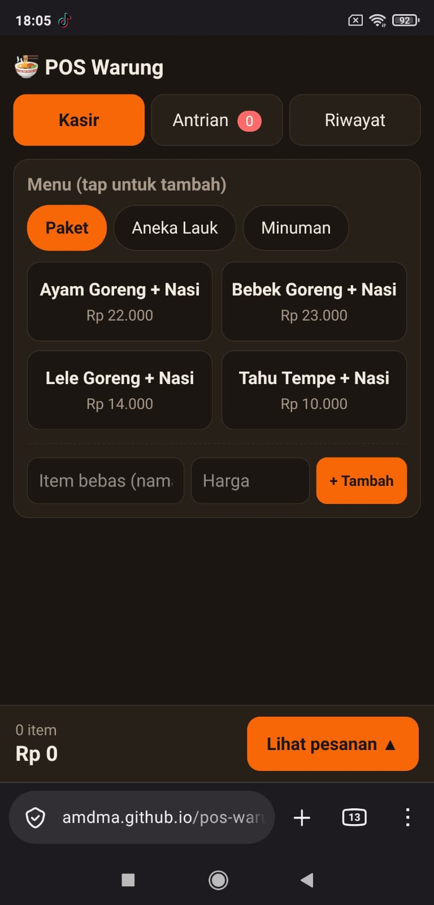
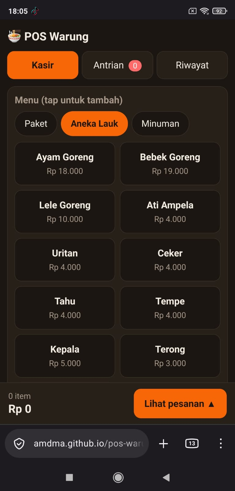
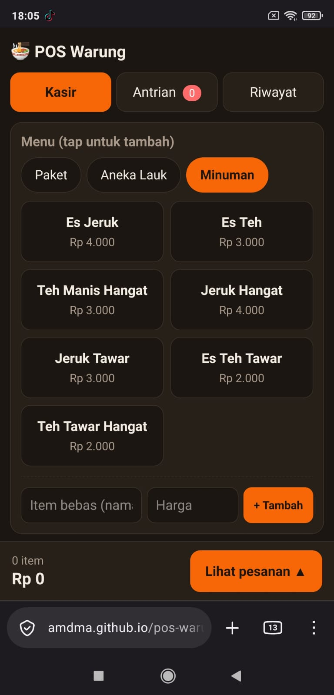
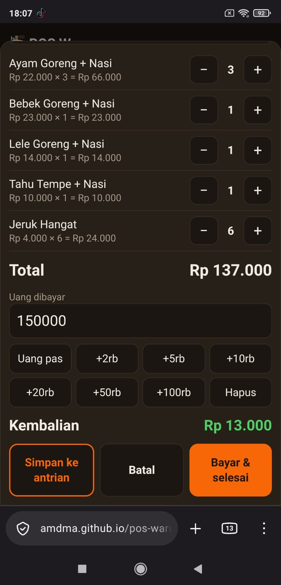
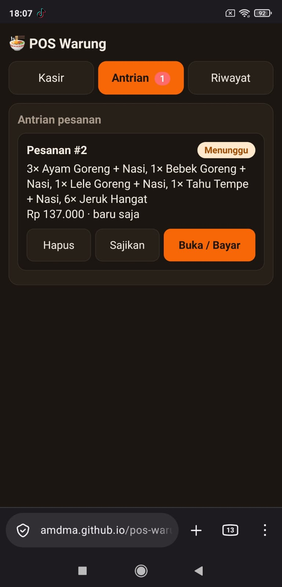
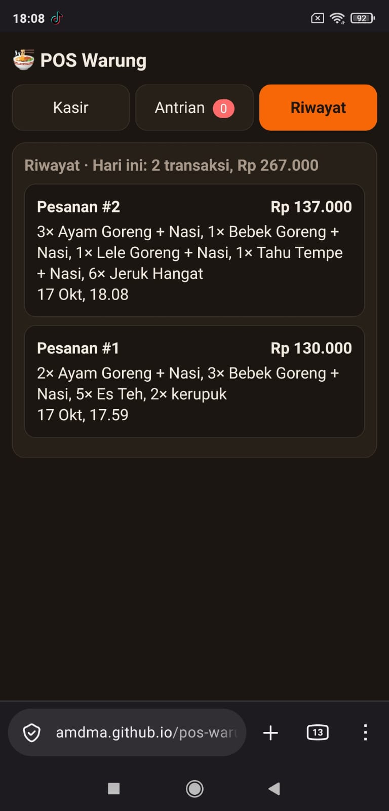

<div align="center">

# 🍜 POS Warung PWA

</div>

Sistem Point of Sale (kasir) berbasis Progressive Web App untuk warung makan, dengan rencana fitur prediksi kebutuhan porsi harian. Dikembangkan sebagai bagian dari tugas akhir/skripsi.

> **Status:** 🚧 Dalam pengembangan. Tahap 1 dan 2 selesai (kasir, antrian, penyimpanan lokal, riwayat). Berikutnya: Tahap 3 (PWA).

<div align="center">
<h1><a id="screenshots"></a>Screenshots</h1>








</div>

**Demo:** https://amdma.github.io/pos-warung-pwa/

---

## Latar Belakang

Pada jam ramai, penghitungan total pesanan di warung masih memakai kalkulator HP. Akibatnya ada menu yang terlewat atau terhitung dobel, dan proses pembayaran jadi lambat. Pembayaran umumnya dilakukan di akhir, sehingga saat pelanggan baru datang di tengah pelayanan, pesanan berikutnya sering terlupa karena hanya diingat, tidak dicatat. Selain itu, jumlah porsi yang disiapkan tiap hari masih berdasarkan perkiraan, sehingga bisa kelebihan (sisa) atau kekurangan (menu habis).

Proyek ini bertujuan:
1. Mempercepat dan mengurangi kesalahan penghitungan pesanan.
2. Mencatat pesanan yang belum dibayar sebagai antrian, supaya tidak ada pesanan yang terlupa.
3. Tetap bisa dipakai saat internet putus (offline-first).
4. Memprediksi kebutuhan porsi hari berikutnya dari data penjualan.

## Fitur

**Sudah ada**
- [x] Menu per kategori (Paket, Aneka Lauk, Minuman) sesuai menu warung
- [x] Keranjang pesanan dengan tombol tambah/kurang, total otomatis, dan kembalian
- [x] Tombol uang cepat yang bisa dijumlahkan (mis. +20rb dan +5rb = 25rb)
- [x] Item bebas dengan harga diketik manual untuk kasus di luar menu
- [x] **Antrian pesanan:** simpan pesanan lebih dulu, bayar setelah disajikan (status: Menunggu, Disajikan, Lunas)
- [x] Penyimpanan di perangkat dengan IndexedDB (antrian tidak hilang saat halaman di-refresh)
- [x] Riwayat transaksi dan ringkasan total hari ini
- [x] Tampilan responsif: bar bawah dan panel pesanan di HP, dua kolom di layar lebar
- [x] Mode terang/gelap mengikuti pengaturan perangkat

**Rencana**
- [ ] PWA: bisa di-install dan jalan offline (manifest dan service worker)
- [ ] Halaman admin untuk mengubah menu dan harga
- [ ] Sinkronisasi ke cloud (Supabase)
- [ ] Laporan penjualan harian dan bulanan per menu
- [ ] Pencatatan menu habis (sold out)
- [ ] Prediksi kebutuhan porsi per menu

## Cara Kerja Antrian

1. Di tab **Kasir**, pilih menu, isi nama/meja (opsional), lalu tekan **Simpan ke antrian**.
2. Di tab **Antrian**, setiap pesanan tampil dengan status dan lama menunggu. Tekan **Sajikan** setelah pesanan diantar.
3. Tekan **Buka / Bayar** untuk memuat pesanan ke kasir, menambah item bila perlu, lalu **Bayar & selesai**.
4. Pesanan lunas pindah ke tab **Riwayat**.

Pelanggan yang langsung membayar bisa memakai **Bayar & selesai** tanpa lewat antrian.

## Teknologi

| Bagian | Teknologi |
|---|---|
| Frontend | HTML, CSS, JavaScript (tanpa framework) |
| Penyimpanan lokal | IndexedDB |
| PWA | Web App Manifest, Service Worker *(rencana)* |
| Backend/Database | Supabase *(rencana)* |
| Prediksi | Python: pandas, statsmodels, scikit-learn *(rencana)* |
| Hosting | GitHub Pages |

## Struktur Data Pesanan

Setiap pesanan disimpan di IndexedDB (database `pos-warung`, store `orders`):

```js
{
  id: 1,                          // otomatis
  label: "Meja 3",                // nama/meja (boleh kosong)
  items: [                        // nama dan harga disalin saat disimpan,
    { id: 1, nama: "Ayam Goreng + Nasi", harga: 22000, qty: 2 }
  ],                              // sehingga riwayat tidak berubah bila harga menu diganti
  total: 44000,
  status: "menunggu",             // menunggu | disajikan | lunas
  dibuat: "2026-10-17T05:10:00Z", // waktu dibuat
  disajikan: "…",                 // waktu disajikan (bila sudah)
  dibayar: "…",                   // waktu dibayar (bila lunas)
  bayar: 50000                    // uang yang diterima (bila lunas)
}
```

Waktu pada setiap tahap memungkinkan analisis lama pelayanan dan menjadi data masukan untuk modul prediksi.

## Cara Menjalankan

```bash
# 1. Clone repo
git clone https://github.com/amdma/pos-warung-pwa.git
cd pos-warung-pwa

# 2. Jalankan server lokal (pilih salah satu)
npx serve .
# atau
python -m http.server 8000
```

Buka `http://localhost:3000` (atau `:8000`) di browser. Untuk mencoba fitur PWA di HP, akses lewat HTTPS (hasil deploy GitHub Pages).

## Cara Mengubah Menu

Edit array `menu` di bagian atas script:

```js
{ id: 1, kategori: "Paket", nama: "Ayam Goreng + Nasi", harga: 22000 },
```

Setiap menu butuh `id` yang unik. Tab kategori dibuat otomatis dari field `kategori`. Tombol uang cepat diatur lewat array `pecahan`.

## Keterbatasan Saat Ini

- Data tersimpan di browser perangkat yang dipakai saja, belum tersinkron antar perangkat (direncanakan di Tahap 5).
- Isi keranjang yang belum disimpan ke antrian hilang jika halaman di-refresh.
- Transaksi yang sudah lunas belum bisa diubah atau dihapus.
- Menu masih diubah lewat kode, belum lewat halaman admin.

## Struktur Proyek

```
pos-warung-pwa/
├── index.html        # Aplikasi (sementara satu file)
├── docs/             # Screenshot, catatan pengembangan
└── README.md
```
<!-- Perbarui saat file mulai dipisah (css/, js/, sw.js, manifest.json) -->

## Metode Prediksi *(rencana)*

Perbandingan beberapa metode untuk memprediksi permintaan per menu per hari:
- Moving Average (baseline)
- Holt-Winters (exponential smoothing)
- SARIMA
- Random Forest / XGBoost

Evaluasi menggunakan MAE, RMSE, dan MAPE.

## Roadmap

- [x] **Tahap 1:** Kalkulator pesanan
- [x] **Tahap 2:** Antrian, penyimpanan IndexedDB, dan riwayat
- [ ] **Tahap 3:** Jadi PWA (manifest, service worker, bisa di-install)
- [ ] **Tahap 4:** Uji coba di warung (berjalan terus, temuan dicatat)
- [ ] **Tahap 5:** Sinkronisasi cloud
- [ ] **Tahap 6:** Laporan dan prediksi

## Catatan Pengembangan

Masalah yang ditemukan saat observasi dan uji coba di warung, beserta keputusan desainnya, dicatat di `docs/catatan.md`. Contoh yang sudah menjadi dasar fitur:

- Pesanan sering terlupa saat banyak pelanggan datang bersamaan, karena pembayaran dilakukan di akhir dan pesanan hanya diingat. Solusinya fitur antrian dengan status.
- Harga dan porsi tidak selalu baku (tambahan satu iris, air putih saja). Solusinya item bebas dan kategori menu yang mengikuti menu cetak.

## Penulis

**Muhammad Abdurrohman**
Mahasiswa Teknik Informatika, Universitas Nusantara PGRI Kediri.
GitHub: [@amdma](https://github.com/amdma)

## Lisensi

Belum ditentukan.